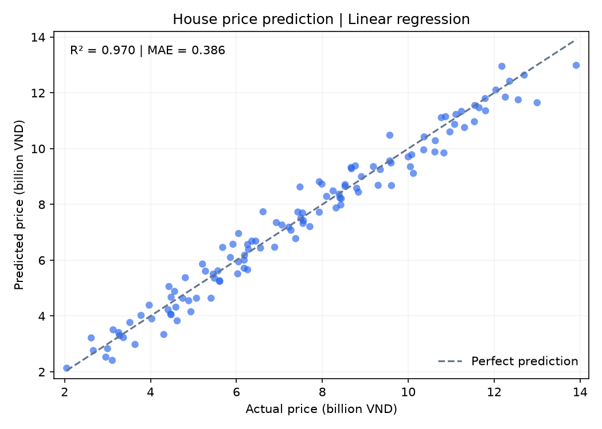

# House Price Prediction

A beginner-friendly machine learning project that estimates house prices from floor area, number of bedrooms, and location using **Multiple Linear Regression**.

  

## Features

- Predict house prices in billion Vietnamese dong (VND).
- Interactive Streamlit interface and an optional command-line interface.
- One-hot encoding for categorical location data using a scikit-learn pipeline.
- Reproducible dataset generation, 80/20 train/test split, and evaluation metrics.
- Actual vs. predicted price visualization and basic automated tests.

## Dataset

The included CSV contains 600 **synthetic** housing records generated using a fixed random seed. The values are illustrative and are not collected from real property listings.

| Column | Description | Values |
| --- | --- | --- |
| `area_m2` | Floor area | 40–250 m² |
| `bedrooms` | Number of bedrooms | 1–6 |
| `location` | Location category | City Center, Inner Suburb, Outer Suburb |
| `price_billion_vnd` | Target price | Billion VND |

The generated target is based on a linear relationship between area, bedrooms, location premium, and random noise. To regenerate it, run `python generate_data.py`.

## How it works

1. Load the dataset with Pandas.
2. Split the data into 480 training and 120 testing records using a fixed random seed.
3. Encode the categorical location with `OneHotEncoder` and pass numeric features through unchanged.
4. Fit a `LinearRegression` estimator inside a preprocessing pipeline using training data only.
5. Evaluate the fitted model on the held-out test set and use it to predict new inputs.

The model learns an equation of the form:

```text
Price = intercept + area_coefficient × area + bedroom_coefficient × bedrooms + location coefficients
```

## Model evaluation

| Metric | Test-set result |
| --- | ---: |
| R² | 0.9704 |
| Mean Absolute Error (MAE) | 0.3862 billion VND |
| Root Mean Squared Error (RMSE) | 0.4871 billion VND |



R² measures the fraction of target variance explained on the test set. MAE and RMSE measure prediction error in the target's units. These results are for the synthetic dataset only; they do not demonstrate real-world pricing accuracy.

## Getting started

Requirements: Python 3.10+ and pip. Open a terminal in the project directory.

Create a virtual environment:

```bash
python -m venv .venv
```

Activate it on Windows PowerShell:

```powershell
.\.venv\Scripts\Activate.ps1
```

Or on macOS/Linux:

```bash
source .venv/bin/activate
```

Install dependencies:

```bash
python -m pip install -r requirements.txt
```

Run the web application:

```bash
python -m streamlit run app.py
```

Open `http://localhost:8501` if the browser does not open automatically. The app trains the model from the included CSV and caches it for subsequent predictions.

### Command-line prediction

```bash
python predict.py --area 100 --bedrooms 3 --location "City Center"
```

Example output:

```text
Estimated price: 7.15 billion VND (synthetic data)
```

### Train and evaluate separately

```bash
python train.py
```

This updates `reports/metrics.json` and `reports/actual_vs_predicted.png`.

### Run tests

```bash
python -m unittest discover -s tests -v
```

## Project structure

```text
house-price-prediction/
├── app.py                         # Streamlit interface
├── model.py                       # Preprocessing, training, prediction
├── train.py                       # Evaluation and visualization
├── predict.py                     # CLI prediction
├── generate_data.py               # Synthetic dataset generator
├── data/
│   └── houses.csv                 # 600 example records
├── reports/
│   ├── actual_vs_predicted.png
│   └── metrics.json
├── tests/
│   └── test_model.py
├── requirements.txt
├── .gitignore
└── README.md
```

## Future improvements

- Replace synthetic data with a properly sourced real-estate dataset.
- Include property age, district, bathrooms, and other useful features.
- Compare Linear Regression with Random Forest and other regression models.
- Deploy the Streamlit app online.

## Disclaimer

This is an educational machine learning project. Its predictions are not suitable for real-world real-estate valuation or financial decisions.
